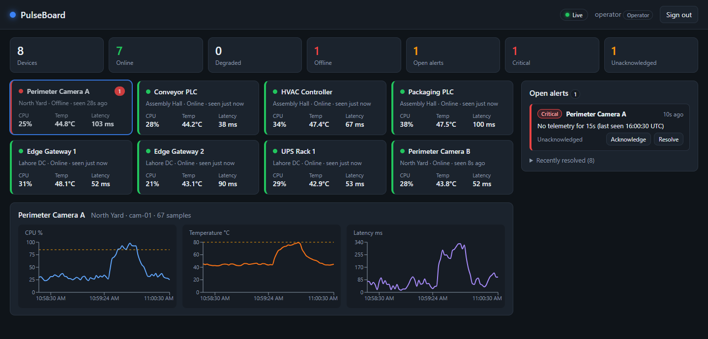

# PulseBoard

[](https://github.com/BoogeyCodes/pulseboard/actions/workflows/ci.yml)


Real-time equipment monitoring console: a fleet of devices streams telemetry, rules turn it into
alerts, and operators watch and act on a live dashboard. Built as a reference for how I structure a
production-shaped full-stack system: **ASP.NET Core 8** API with JWT and role-based policies, a
**System.Threading.Channels** processing pipeline, **SignalR** push, **EF Core + Dapper** over the
same database, and a **React 19 + TypeScript + Redux Toolkit** frontend with live charts. One
Docker image ships the lot.



## What it does

- **Devices** report CPU, temperature and latency. Each one is `Online`, `Degraded` (a rule is
  firing) or `Offline` (no telemetry for 15 s).
- **Alerts** are raised by threshold rules, escalate or de-escalate in place, auto-resolve when
  the condition clears, and can be acknowledged or resolved by an operator. Acknowledging says "a
  human has seen this"; resolving closes it.
- **Live updates**: every sample, device state change and alert change is pushed to connected
  dashboards over SignalR. Reconnects refetch the REST snapshots so nothing is missed.
- **Roles**: `Viewer` can look, `Operator` can acknowledge and resolve, `Admin` can do everything.
  Enforced server-side by authorization policies and reflected in the UI.
- **Simulator**: a built-in producer gives the eight demo devices a random walk with occasional
  load spikes and outages, so the dashboard is alive the moment it starts. Swap it for a real
  ingest (MQTT, HTTP, Kafka) by writing to the same channel.

## Run it

### Docker (one container, nothing else to install)

```bash
docker compose up --build
# open http://localhost:8080  ->  sign in as operator / pulse123
```

### Local development

Backend on <http://localhost:5100> (Swagger at `/swagger`), frontend on <http://localhost:5173>
proxying `/api` and `/hubs` to it:

```bash
dotnet run --project src/PulseBoard.Api        # terminal 1
cd web && npm install && npm run dev           # terminal 2
```

Demo accounts (all with password `pulse123`): `viewer`, `operator`, `admin`.

### Tests

```bash
dotnet test                 # 23 tests: rules, auth, pipeline, REST, SignalR
cd web && npm test          # 8 tests: reducers/selectors, components, API calls
```

## Architecture

```
                 ┌──────────────────────── PulseBoard.Api (ASP.NET Core 8) ────────────────────────┐
  simulator /    │  TelemetrySimulator ─┐                                                          │
  real ingest ───┼──────────────────────┤  Channel<TelemetrySample> (bounded, drop-oldest)         │
                 │                      └──► TelemetryWorker (single consumer)                     │
                 │                               │  per sample, scoped TelemetryProcessor:         │
                 │                               │   • persist Reading (EF Core)                   │
                 │                               │   • update Device last-known state              │
                 │                               │   • AlertRules.Evaluate -> raise / escalate /   │
                 │                               │     auto-resolve Alerts                         │
                 │                               │   • broadcast via IHubContext<TelemetryHub>     │
                 │                               └─ every 5 s: heartbeat sweep -> Offline alerts,  │
                 │                                  retention purge (Dapper)                       │
                 │                                                                                 │
                 │  REST  /api/auth  /api/devices  /api/devices/{id}/readings  /api/alerts  /api/summary
                 │  Hub   /hubs/telemetry  (DeviceUpdated, ReadingReceived, AlertRaised, AlertUpdated)
                 └─────────────────────────────────────────┬───────────────────────────────────────┘
                                                           │ JWT bearer (header for REST, query string for WS)
                 ┌─────────────────────────────────────────┴───────────────────────────────────────┐
                 │  web (React 19 + TypeScript)                                                    │
                 │  Redux Toolkit slices: auth · devices · alerts · readings (ring buffer) · connection
                 │  useTelemetryHub: one SignalR connection -> dispatches into the store           │
                 │  Components: SummaryBar · DeviceGrid/DeviceCard · DeviceDetail (Recharts) · AlertsPanel
                 └─────────────────────────────────────────────────────────────────────────────────┘
```

### Backend decisions

| Concern | Choice | Why |
| --- | --- | --- |
| Ingest → processing | `Channel<T>`, bounded 1024, `DropOldest`, single reader | Producers never block; back-pressure is explicit; one writer touches device state so there are no races |
| Processing unit | Scoped `TelemetryProcessor` per sample | Fresh `DbContext` per unit of work; testable without the hosted service |
| Rules | Pure static `AlertRules.Evaluate(sample)` | Trivial to unit test; the processor does the stateful reconcile (raise / escalate / auto-resolve) |
| Persistence | EF Core (schema, writes) + Dapper (hot reads, purge) | EF for the model, Dapper where the SQL and its index usage should be explicit |
| Auth | JWT, `PasswordHasher<T>`, named policies (`CanView`, `CanOperate`, `CanAdminister`) | Endpoints reference capabilities, not role strings; the token also authenticates the WebSocket |
| Realtime | SignalR with a typed `Hub<ITelemetryClient>` | Server cannot misspell a client method; reconnect handled by the client library |
| Errors | `ProblemDetails`, typed results (`Results<Ok<T>, NotFound, Conflict<string>>`) | OpenAPI documents every outcome |
| Logging | Serilog, request logging, structured properties | Searchable `{DeviceId}` / `{Kind}` fields rather than string soup |

### Frontend decisions

- **Redux Toolkit** rather than component state, because the same device/alert data feeds the
  summary tiles, the grid, the detail panel and the alert list, and all of it changes from a
  background WebSocket.
- **Memoised selectors** (`createSelector`) do sorting and counting once per state change.
- **Readings ring buffer** keeps 300 points per device in memory; history is fetched via REST when
  a device is selected and merged with anything that streamed in meanwhile.
- **Role-gated actions**: the UI hides operator buttons from viewers, and the API would return 403
  anyway. Tested on both sides.
- **No router, no UI kit**: the console is one screen; plain CSS keeps the bundle honest.

### Testing approach

- Backend tests boot the real app with `WebApplicationFactory`, the simulator switched off, a
  throwaway SQLite file and a fake clock. Tests push samples through `TelemetryProcessor` exactly as
  the worker would, then assert over REST and over a real SignalR client connection. Expiry and
  offline detection are tested by advancing the clock, not by sleeping.
- Frontend tests cover reducers and selectors with a real store, components with Testing Library,
  and the acknowledge flow against a stubbed `fetch` that asserts the bearer header.

## Project layout

```
src/PulseBoard.Api
├── Program.cs                 composition root
├── Auth/                      JwtOptions, TokenService, Policies
├── Contracts/Dtos.cs          wire types shared by REST and the hub
├── Domain/                    Device, Reading, Alert, User
├── Endpoints/                 Auth, Devices (+summary), Alerts
├── Hubs/TelemetryHub.cs       typed SignalR hub
├── Infrastructure/            AppDbContext, DbSeeder, ReadingsRepository (Dapper), IClock
└── Telemetry/                 Channel, Sample, AlertRules, Processor, Worker, Simulator
tests/PulseBoard.Api.Tests     xUnit: rules, auth, pipeline + REST + SignalR
web/src
├── api/                       fetch client and types
├── store/                     Redux Toolkit slices and selectors (+ tests)
├── realtime/                  useTelemetryHub
├── components/                LoginPage, Header, SummaryBar, DeviceGrid, DeviceCard, DeviceDetail, AlertsPanel (+ tests)
└── utils/format.ts
Dockerfile · docker-compose.yml · .github/workflows/ci.yml
```

## Configuration

| Setting | Default | Notes |
| --- | --- | --- |
| `ConnectionStrings:Default` | `Data Source=pulseboard.db` | SQLite; swap the EF provider for PostgreSQL in `Program.cs` |
| `Jwt:Key` | dev key in `appsettings.json` | Must be ≥ 32 bytes. **Override in any real deployment** (`Jwt__Key` env var) |
| `Jwt:LifetimeMinutes` | `480` | |
| `Telemetry:SimulatorEnabled` | `true` | Set `false` when wiring a real ingest |
| `Telemetry:SampleIntervalSeconds` | `2` | |
| `Telemetry:OfflineAfterSeconds` | `15` | Heartbeat threshold |
| `Telemetry:RetentionMinutes` | `120` | Readings older than this are purged |
| `Cors:Origins` | `["http://localhost:5173"]` | Only needed for the Vite dev server |

## Where I'd take it next

- PostgreSQL + EF migrations and a Redis backplane for SignalR, so several API instances can share load
- Real ingest: an MQTT subscriber writing into the same channel
- Alert routing (email / Slack webhook) with per-site on-call rules
- Per-device thresholds editable by admins instead of constants
- OpenTelemetry traces and metrics; the structured logs are already there

## License

MIT
